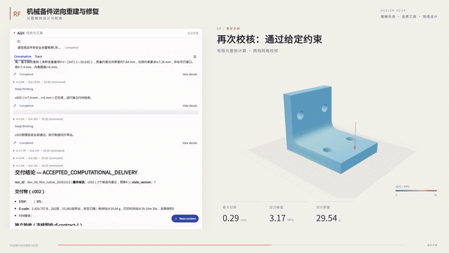
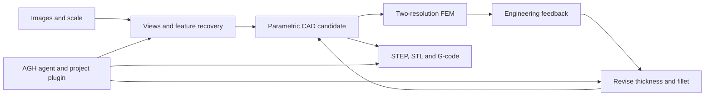

# Mechanical Spare-Part Reconstruction and Repair

English | [简体中文](README.zh-CN.md)

From images of a damaged mechanical part to a revised parametric design and manufacturing files, with reconstruction and engineering feedback in one workflow.

## Project overview

When drawings are missing, recreating a spare part requires more than copying its appearance: features must be recovered, dimensions represented in a workable CAD model, and design changes evaluated before manufacturing. This project connects these steps for a bracket example.

1. Inspect the input images and reference scale, then recover views and geometric features.
2. Build candidate parametric CAD and evaluate it using finite-element analysis at two mesh resolutions.
3. Revise parameters such as thickness and fillet radius based on feedback.
4. Export STEP and STL models and a PrusaSlicer G-code file.

The included bracket case uses 18 synthetic images and a 20 mm scale reference in [inputs/bracket](inputs/bracket). The repository supplies the reconstruction, CAD, simulation, export workflow and project-specific plugin. Agnes Harness (AGH) is installed separately; its multimodal capabilities support the workflow rather than being reimplemented here.

## Demo video

[](demo/机械备件逆向重建与修复.mp4)

[Full video](demo/机械备件逆向重建与修复.mp4) · [Local player](demo/watch.html) · [Bracket image](demo/bracket.jpg)

The demonstration walks through visual inspection, reconstruction, design evaluation and export.

## Architecture



| Stage | Output / tools |
| --- | --- |
| Visual reconstruction | Images, reference scale and recovered features |
| Candidate design | Parameterized CAD model and design variants |
| Evaluation | Gmsh meshes and scikit-fem analysis at two resolutions |
| Manufacturing | STEP and STL export followed by PrusaSlicer G-code |

Details of the reconstruction and design pipeline are in [reconstruction-and-design](docs/reconstruction-and-design.md).

## Integration standards and getting started

### Agent contract

The project plugin exposes `view_photos`, `reconstruct_views`, `inspect_features`, `propose_cad`, `evaluate_design`, `list_candidates`, `revise_cad` and `export_manufacturing`. `view_photos` takes a `run_id` and one frame in `frame_ids`. State-changing operations identify the run, decision and state version; evaluation and export identify the relevant candidate. Revision can adjust thickness and fillet parameters. See [plugin/index.mjs](plugin/index.mjs) for exact schemas.

Images and scale form the input to the reconstruction. Outputs include candidate geometry and manufacturing files; finite-element results provide feedback for design revision.

### Reproduce the bracket workflow

On Ubuntu 24.04 with Python 3.12 and Node.js 24:

```bash
sudo apt-get install libgl1 libglu1-mesa libglib2.0-0t64 prusa-slicer
bash scripts/bootstrap.sh
source .venv/bin/activate
export PYTHONPATH="$PWD/src"
python recipes/rebuild_bracket.py
```

The included recipe uses 7.4 mm thickness and a 6 mm fillet. For the AGH-driven workflow, install AGH separately and prepare its CLI:

```bash
export AGH_SOURCE_DIR=/opt/agnes-harness
(cd "$AGH_SOURCE_DIR" && pnpm install --frozen-lockfile && pnpm --filter @agnes/cli build:local)
python scripts/connect_runtime.py
cp .env.example .env
# Set MODEL_BASE_URL and REPAIRFORGE_MODEL_API_KEY in .env
set -a; source .env; set +a
bash start.sh --live --port 49905 --foreground
```

In a second terminal:

```bash
source .venv/bin/activate
export PYTHONPATH="$PWD/src"
python scripts/run_vision_and_export.py --run-id repair_001 --case-id bracket
```

The workbench is available at `http://127.0.0.1:49905/`. Read [GETTING_STARTED.md](GETTING_STARTED.md) for complete prerequisites, [NOTICE.md](NOTICE.md) for notices and [LICENSE](LICENSE) for project terms.
