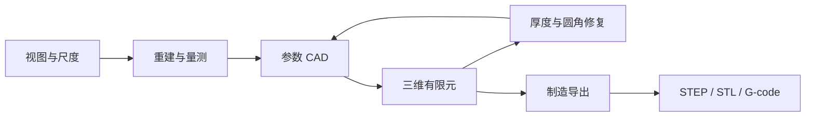

# 机械备件逆向重建与修复

从已有部件找回几何，依据使用条件修改结构，再生成可继续制造的设计文件。

[](demo/机械备件逆向重建与修复.mp4)

**[观看完整案例](demo/机械备件逆向重建与修复.mp4)** · [独立播放器](demo/watch.html) · [运行说明](GETTING_STARTED.md)

## 从一个缺图纸的支架开始

设备改造、备件替换或工装调整时，手里可能只有一个现有零件和若干照片。重新制造并不只是把外形复制出来，还需要找回尺寸、保留装配接口、根据载荷修改结构，并准备制造文件。

这个项目把上述环节接进同一条设计流程：通过多视图和尺度参考进行量测，用参数 CAD 表达结构，运行有限元计算查看响应，再修改厚度与圆角，重新校核并导出 STEP、STL 和 G-code。

AGH 接收图片和设计要求，选择领域工具并阅读计算反馈。几何、力学和切片由对应专业软件执行，过程面板联动展示设计变化。

## 一次修复有哪些输入与产物

| 环节 | 输入 | 产物 |
|---|---|---|
| 几何重建 | 多视图、尺度参考 | 重建与量测结果 |
| 特征提取 | 观察得到的几何 | 平面、孔距、厚度等参数 |
| 参数建模 | 当前参数与结构先验 | 可修改的 CAD 实体 |
| 结构校核 | 几何、材料与载荷设置 | 位移、应力及约束检查 |
| 设计修复 | 上一轮计算反馈 | 新厚度、圆角和候选实体 |
| 制造导出 | 校核后的设计 | STEP、STL 与切片路径 |

随仓库提供的支架案例位于 `inputs/bracket/`，包含 **18 张仿真视图和 20 mm 尺度参考**。这个输入可以被重新计算，示例的工程产物由本机运行生成。

## 技术实现落在哪里

项目实现了一个从观测到制造的工程链路，而每一环都包含具体的计算与接口工作。

- **多视图量测**：将图像、参考板与重建过程连接，提取能够用于后续设计的几何参数。
- **参数 CAD**：用显式结构参数表达支架，使接口和可修改部分在后续候选中延续。
- **有限元反馈**：使用 Gmsh 和 scikit-fem 进行三维结构计算，并通过两档网格检查设计响应。
- **修复迭代**：把厚度、内角圆角与计算结果关联起来，为新候选重新执行校核。
- **制造衔接**：通过 PrusaSlicer 命令行生成切片文件，连接设计实体与制造路径。
- **原生多模态接入**：使用 AGH 原生图像与工具机制，把输入图片、八个领域工具和过程面板连接到同一设计任务。
- **设计状态管理**：管理输入、候选、版本、计算结果与制造产物之间的关系。



### 八个领域工具

| 工具 | 在流程中的作用 |
|---|---|
| `view_photos` | 查看输入视图 |
| `reconstruct_views` | 执行多视图重建 |
| `inspect_features` | 拟合和检查可观察特征 |
| `propose_cad` | 生成初始参数实体 |
| `evaluate_design` | 进行结构计算和校核 |
| `list_candidates` | 读取当前设计与候选状态 |
| `revise_cad` | 根据反馈建立修复候选 |
| `export_manufacturing` | 输出制造文件和切片 |

这些工具把可视输入、工程计算和设计动作连起来。AGH 的基础多模态能力与项目的专业工具实现分别承担各自职责。

## 先运行工程配方

建议环境为 Ubuntu 24.04、Python 3.12 和 Node.js 24。安装系统图形与切片组件：

```bash
sudo apt-get install libgl1 libglu1-mesa libglib2.0-0t64 prusa-slicer
bash scripts/bootstrap.sh
source .venv/bin/activate
python recipes/rebuild_bracket.py
```

`recipes/rebuild_bracket.py` 会重新读取支架输入，完成重建、特征、初始 CAD、结构计算、修复和制造导出。配方使用厚度 **7.4 mm**、圆角 **6 mm** 作为修复参数，供完整工程链路的重算使用。

新产物写入独立 `runs/example_*` 目录。检查结果时，可沿同一个任务查看量测、候选 CAD、结构计算和制造输出。

## 再运行智能体修复任务

连接单独安装的 AGH 工作区：

```bash
export AGH_SOURCE_DIR=/opt/agnes-harness
(cd "$AGH_SOURCE_DIR" && pnpm install --frozen-lockfile && pnpm --filter @agnes/cli build:local)
python scripts/connect_runtime.py
```

连接脚本使用外部 CLI 和 SDK，构建文件保存在已忽略的 `runtime/`。可使用 `--check` 预先检查路径。任务文本位于 `configs/task.txt`。

复制环境文件，填写模型服务地址和 `REPAIRFORGE_MODEL_API_KEY`：

```bash
cp .env.example .env
```

启动本项目工作台和模型接入：

```bash
source .venv/bin/activate
set -a; source .env; set +a
bash start.sh --live --port 49905 --foreground
```

在另一个终端提交支架任务：

```bash
source .venv/bin/activate
export PYTHONPATH="$PWD/src"
python scripts/run_vision_and_export.py \
  --run-id bracket_repair_001 \
  --case-id bracket
```

工作台为 **http://127.0.0.1:49905/**。该入口把图片与需求交给原生多模态会话，智能体依据观察和工具反馈选择后续设计操作。环境与服务步骤可查阅 [GETTING_STARTED.md](GETTING_STARTED.md)。

## 按工程环节阅读源码

```text
inputs/bracket/                 支架多视图与尺度输入
recipes/rebuild_bracket.py       工程重算配方
src/repairforge/
  reconstruct.py                图像与几何重建
  features.py                   几何特征
  physics.py                    参数实体与力学基础
  evaluate.py                   结构计算与校核
  manufacture.py                制造导出与切片
  service.py                    领域操作
  authority.py                  候选和设计状态
plugin/                         八个原生工具
panel/                          设计过程面板
configs/                        结构与打印设置
```

[重建与设计说明](docs/reconstruction-and-design.md)给出模块之间的数据流。

对于结构和制造模块，可以在已安装完整专业依赖的环境中运行：

```bash
pip install -r requirements-dev.txt
PYTHONPATH=src python -m pytest tests/test_design_loop.py -q
```

这个检查从参数结构出发，验证结构修改、有限元计算和实际切片产物。设计状态的检查位于 `tests/test_authority.py`。

## 许可与组件


代码使用的几何、力学、切片和智能体组件见 [NOTICE.md](NOTICE.md)；项目许可见 [LICENSE](LICENSE)。
