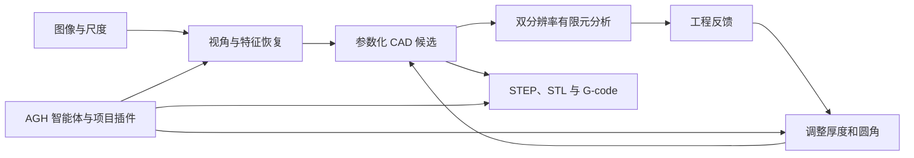

# 机械备件逆向重建与修复

[English](README.md) | 简体中文

从受损机械件的图像出发，完成特征重建、参数化设计、工程评估与制造文件导出。

## 项目介绍

缺少图纸时，备件修复不仅要恢复外观，还需要从图像提取结构特征、建立可修改的 CAD 模型，并在制造前评估设计修改。本项目以支架为例，把这些环节连接起来。

1. 查看输入图像与尺度参考，恢复视角和几何特征。
2. 建立参数化候选模型，并在两种网格分辨率下进行有限元分析。
3. 根据反馈调整厚度、圆角等参数。
4. 导出 STEP、STL，并通过 PrusaSlicer 生成 G-code。

示例输入位于 [inputs/bracket](inputs/bracket)，包含 18 张合成图像和 20 mm 尺度参考。仓库提供重建、CAD、仿真、导出流程及项目插件。Agnes Harness（AGH）需单独安装，其多模态能力为流程提供基础支持。

## 演示视频

[](demo/机械备件逆向重建与修复.mp4)

[观看完整视频](demo/机械备件逆向重建与修复.mp4) · [本地播放页](demo/watch.html) · [支架图片](demo/bracket.jpg)

视频展示了视觉观察、重建、设计评估和文件导出。

## 技术架构



| 阶段 | 主要结果与工具 |
| --- | --- |
| 视觉重建 | 图像、尺度参考与提取的特征 |
| 候选设计 | 参数化 CAD 模型和设计方案 |
| 工程评估 | 使用 Gmsh 网格和 scikit-fem 进行双分辨率分析 |
| 制造导出 | STEP、STL 和 PrusaSlicer G-code |

详细流程见 [重建与设计说明](docs/reconstruction-and-design.md)。

## 集成标准与使用

### 智能体接口

项目插件提供 `view_photos`、`reconstruct_views`、`inspect_features`、`propose_cad`、`evaluate_design`、`list_candidates`、`revise_cad`、`export_manufacturing`。`view_photos` 接收 `run_id` 和 `frame_ids` 中的一张图；改变状态的操作携带运行、决策和状态版本，评估与导出还指定候选方案；修改操作可调整厚度和圆角。准确参数以 [plugin/index.mjs](plugin/index.mjs) 为准。

图像和尺度是重建输入，候选几何与制造文件是输出，有限元结果为设计调整提供依据。

### 复现支架流程

在 Ubuntu 24.04、Python 3.12 和 Node.js 24 环境下：

```bash
sudo apt-get install libgl1 libglu1-mesa libglib2.0-0t64 prusa-slicer
bash scripts/bootstrap.sh
source .venv/bin/activate
export PYTHONPATH="$PWD/src"
python recipes/rebuild_bracket.py
```

示例脚本使用 7.4 mm 厚度和 6 mm 圆角。若使用 AGH 智能体，先单独安装 AGH 并准备 CLI：

```bash
export AGH_SOURCE_DIR=/opt/agnes-harness
(cd "$AGH_SOURCE_DIR" && pnpm install --frozen-lockfile && pnpm --filter @agnes/cli build:local)
python scripts/connect_runtime.py
cp .env.example .env
# 在 .env 中设置 MODEL_BASE_URL 和 REPAIRFORGE_MODEL_API_KEY
set -a; source .env; set +a
bash start.sh --live --port 49905 --foreground
```

在另一个终端运行：

```bash
source .venv/bin/activate
export PYTHONPATH="$PWD/src"
python scripts/run_vision_and_export.py --run-id repair_001 --case-id bracket
```

工作台地址为 `http://127.0.0.1:49905/`。完整环境要求见 [GETTING_STARTED.md](GETTING_STARTED.md)，第三方说明见 [NOTICE.md](NOTICE.md)，项目许可见 [LICENSE](LICENSE)。
