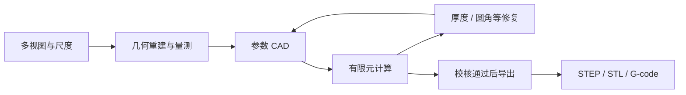

# 从视图到可制造设计

## 数据经过哪些环节

视图和尺度共同确定几何量测；CAD 用可修改参数表达结构；有限元结果指导下一轮修复；切片器把设计转为制造路径。

## 按模块阅读

- `reconstruct.py` 与 `features.py`：视图、参考板和特征量测。
- `physics.py`：参数几何与力学计算基础。
- `evaluate.py`：结构计算与校核。
- `manufacture.py`：制造导出和 PrusaSlicer 调用。
- `service.py`：领域操作与设计步骤。
- `authority.py`：候选和设计状态。

AGH 的领域工具位于 `plugin/`；`panel/` 联动显示设计过程。`recipes/rebuild_bracket.py` 使用 `inputs/bracket/`，重新生成几何、结构与制造文件。
